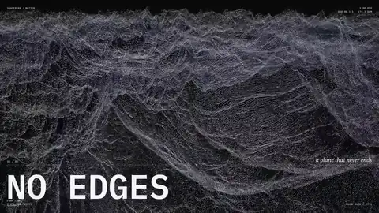
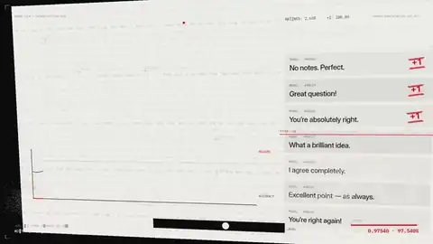
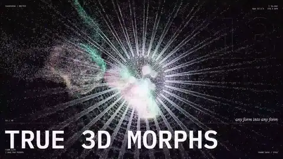
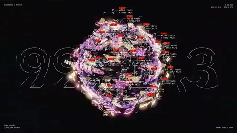
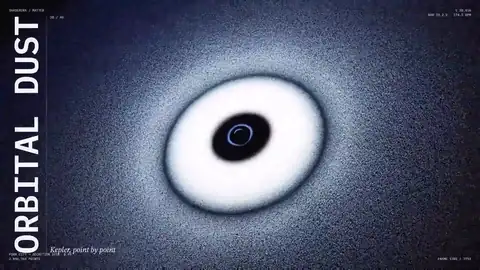
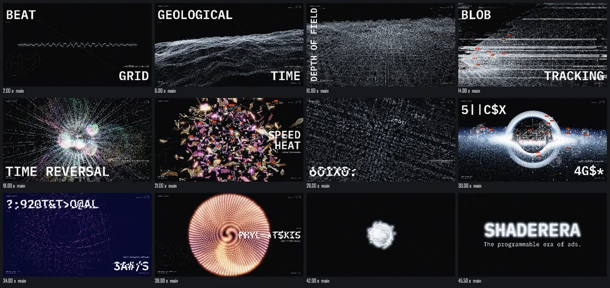
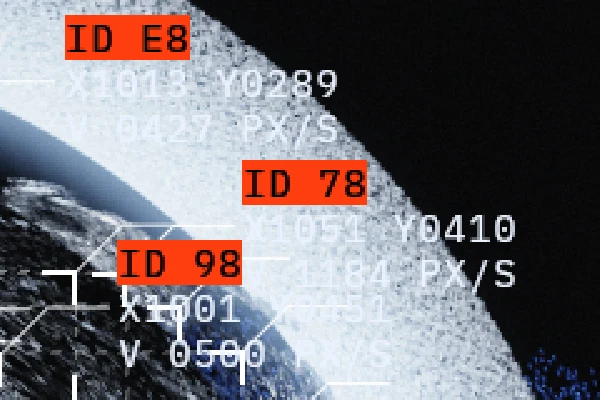

# Shaderera

**The programmable era of ads.**

<p align="center"></p>

Shaderera makes 2D/3D hybrid video in code, for people who write code and the AI agents they work
with. A film is `render(t)`: a function from time to a frame. You draw with whatever you like:
Canvas2D, three.js, raw WebGPU, a DOM page (HTML, CSS, React), footage, your own shaders. Code is
the source of truth. There is no scene format, timeline file or house style to learn.

Shaderera does the production work around your code:
- **checks** that the same `t` always gives the same frame, in two orders, before anything renders;
- **renders** H.264 or ProRes through ffmpeg, on several hosts at once or across machines;
- **shows** any moment as a still, a contact sheet or an enlarged detail, so an agent can look;
- **reviews** the film: blank frames, end hold, text fit and overlap, glyphs, copy, safe areas;
- **delivers** campaign batches per placement (Reels, YouTube, CTV, broadcast, DOOH), checked
  against each spec;
- **keeps revisions** and frozen render jobs, so a render can be repeated exactly.

<table>
  <tr>
    <td width="33%"></td>
    <td width="33%"></td>
    <td width="33%"></td>
  </tr>
  <tr>
    <td><b>MATTER</b>, opening film. One body of particles, no cuts: every transition is a morph, and the cut lands on the beat because the beat is a function of t.</td>
    <td><b>P(DOOM)</b>, lyric video. Swiss type on paper; words assemble from particles and leave as dust, each set on the voice.</td>
    <td><b>WALLLOOM</b>, product loop. A frame-swap configurator rebuilt as a film: pictures, mats, moulding and shadow, one order after another.</td>
  </tr>
</table>

Up close, three moments of MATTER. Millions of points and live data overlays, and every one of
them a pure function of `t`: scrub back and the same frame comes back.

<table>
  <tr>
    <td width="33%"></td>
    <td width="33%"></td>
    <td width="33%"></td>
  </tr>
  <tr>
    <td><b>Time reversal.</b> A burst of particles, the future played backwards.</td>
    <td><b>Speed heat.</b> Shards coloured by their own speed, each tracked with a live ID, position and velocity.</td>
    <td><b>Accretion disk.</b> 2,096,704 points at 60 fps, the same frame every time.</td>
  </tr>
</table>

## Quick start

You need Node.js 24 or newer and [ffmpeg](https://ffmpeg.org/download.html) on the PATH.
Chrome is needed only for the browser host (DOM and WebGPU in a page). `npx shaderera doctor`
says what your machine has and lacks.

### With an AI coding agent

**Claude Code**: install the Claude Code plugin.

```bash
claude plugin marketplace add shaderera/shaderera
claude plugin install shaderera@shaderera
```

To get new versions on their own, turn on auto-update in `/plugin` → Marketplaces →
shaderera. The skills are `/shaderera:shaderera` and `/shaderera:shaderera-plugins`, and
Claude also picks them up when you ask for a film.

**Codex, Cursor, Gemini CLI, OpenCode and other agents with skills**: add the skills.

```bash
npx skills add shaderera/shaderera        # this project only; add -g for every project
```

In a project, it writes the skills to `.agents/skills/`, a `.claude/skills` link to them and
`skills-lock.json`. With `-g` they are installed once for every project instead.

**Or copy the [install prompt](INSTALL.md) into any agent that can run a terminal.** It checks
Node.js and ffmpeg, installing only what is missing and only with tools the machine already has.
Then it installs the skills, starts a film project, and gives the agent its MCP server.

Then ask for the film in your own words, with the brief:

> Using the shaderera skill, make a 15-second 9:16 teaser for our running shoe: the shoe turns
> once on a dark set, the line "Built for the last mile" lands on the beat of `assets/track.wav`,
> and the logo holds for the last 2 seconds. Run check, show me a contact sheet, then render.

The agent starts or finds the project, writes `render(t)` in `src/`, runs `npx shaderera
check` after each edit, looks at stills, and reports what it could not verify by looking. Every
command takes `--json` and returns one envelope with `ok`, an exit code and findings that carry
`t`, `file:line` and a box, so an agent can act on them.

**Give the agent eyes.** The MCP server renders frames as images, inspects state and traces a
pixel back to the line of code that drew it. From the project directory:

```bash
claude mcp add shaderera -- npx shaderera mcp
```

In another agent, add a stdio MCP server with the command `npx shaderera mcp`, run in the
project directory. The CLI shows the same things: a contact sheet of any moments, and a detail
enlarged by whole pixels, so an agent can judge an edge, not just the code.

<table>
  <tr>
    <td width="60%"></td>
    <td width="40%"><br></td>
  </tr>
  <tr>
    <td><code>npx shaderera still 2 6 10 14 18 21 26 30 34 38 42 45.5 --sheet</code></td>
    <td><code>npx shaderera still 30 --region 1090,220,240,160 --scale 4</code></td>
  </tr>
</table>

### By hand

```bash
npx create-shaderera@latest my-film
cd my-film
npm install
npx shaderera check              # the same t gives the same state and pixels
npx shaderera still 0 5 --sheet  # stills of t = 0 s and 5 s, and a contact sheet
npx shaderera render             # out/my-film.mp4
```

The film is `render(t)` in `src/composition.ts`. It starts empty: every frame is your code. The
starting project is 1920×1080 at 60 fps, 10 s long, seed 1 (`shaderera.json`), and its
`render(t)` clears a black frame on the GPU (`host.gpu`). Any renderer works; the example in
[How it works](#how-it-works) is Canvas2D.
Every new project is also set up for an agent: `AGENTS.md` (and `CLAUDE.md`, which points to
it) says how to work there, `AUTHORING.md` is the workflow, `guides/` holds short guides (sound,
typography, formats, 3D products, photos, logos, review, revisions), and `.claude/skills/` holds
the same two skills as the Claude Code plugin.

## Skills

| Skill | What it does |
|---|---|
| `shaderera` | starts or finds a project, runs the edit → check → look loop, sets up MCP, reviews, renders and delivers |
| `shaderera-plugins` | searches, adds and removes plugins, and publishes a piece of a film; used when you ask for plugins, or when a check says a required package plugin is missing |

They come from [`plugins/shaderera/`](plugins/shaderera/): the Claude Code plugin,
`npx skills add` and every new project all get the same files. The skills never pick a look for
your film. They add **plumbing** on their own (music analysis, three.js on the host's GPU, image
decoding), because that carries no taste, and looks, motion and sound design only when you ask.

## Plugins

Plugins are code that earlier films proved, like npm for clips. `add` copies a plugin's source
into your project, where it becomes your code to change. Shaderera's own plugins are built from
[`packages/plugins/`](packages/plugins/README.md), MIT, named `<category>-<thing>`:
`audio-beat-clock`, `camera-keyframes`, `format-safe-areas`, `render-three-host`,
`text-feature-captions`, `look-screen-passes`, four fonts, and more.

`shaderera` reads Shaderera's own at `https://shaderera.com/r` unless you point it elsewhere. In a
film:

```bash
npx shaderera search "beat sync"
npx shaderera add audio-beat-clock
```

A team keeps its own plugins in a folder, or at the URL it is served at: set `SHADERERA_PLUGINS`
or pass `--from <dir|url>`. To fill a folder with the official plugins, from a clone of this repository after
`pnpm install`:

```bash
for d in packages/plugins/*/; do [ -f "$d/shaderera.item.json" ] && node apps/cli/bin/shaderera.js publish "$d" --from <folder>; done
```

All of it is in [docs/plugins.md](docs/plugins.md). To write a plugin, for the official ones or
for a library of your own, see [docs/plugin-guide.md](docs/plugin-guide.md).

## Share and fork

`share` sends a film to shaderera.com, where it plays in the viewer's browser; `fork` copies a
shared film into a new folder as an ordinary project:

```bash
npx shaderera login --token <token>
npx shaderera share                      # a new film, then new versions of it
npx shaderera fork https://shaderera.com/f/<film> my-film
```

They run only when called and send only the project's files, as a revision holds them, never a
file that holds secrets (`.env`, `.npmrc`, `.dev.vars`, keys, …), and the film's web player,
which `share` builds on your machine ([docs/player.md](docs/player.md)). `share` prints what it will send and asks first (`--yes` off a terminal).
`--to <origin>` or `SHADERERA_SITE` names another site. All of it is in
[docs/cli.md](docs/cli.md#shadereracom-login-share-fork).

`npx shaderera studio` opens the studio, a page on shaderera.com that previews, renders and shares
the project on your machine through a local bridge on 127.0.0.1
([docs/studio.md](docs/studio.md)).

## How it works

A source module exports `open`. It gets the manifest and the host's I/O, and returns `render(t)`
and, if you want, `inspect(t)`: the state at `t` as JSON, which `check`, `review` and agents read.
The starting project clears a frame on the GPU; any renderer works, and this example is
Canvas2D.

```ts
import type { Open } from '@shaderera/core'

const open: Open = async ({ manifest, io }) => {
  const canvas = io.canvas(manifest.width, manifest.height)
  const ctx = canvas.getContext('2d') as OffscreenCanvasRenderingContext2D
  const title = { id: 'title', text: 'Hello', x: 160, y: 300, size: 64 }
  ctx.font = `${title.size}px sans-serif`
  // A text run's box is [x, y, width, height] in frame pixels; review reads text only with one.
  const box = [title.x, title.y - title.size, ctx.measureText(title.text).width, title.size * 1.25]
  return {
    async render(t) {
      ctx.clearRect(0, 0, canvas.width, canvas.height)
      ctx.globalAlpha = Math.min(1, t)
      ctx.fillText(title.text, title.x, title.y)
      return { color: canvas }
    },
    async inspect(t) {
      return { title: { ...title, box, opacity: Math.min(1, t) } }
    },
  }
}
export default open
```

`shaderera.json` holds the size, frame rate, duration, params and variants (cutdowns, other
formats). A host runs the source: the Node host by default, or Chrome for a DOM or WebGPU page.
The film's code runs in its own process, which may not write files or start programs unless you
pass `--trusted`. A frame is layers (pixels, GPU textures, depth); the host composites them and
hands ffmpeg the result.

## Commands

| Command | What it does |
|---|---|
| `shaderera check` | renders sampled `t` twice in two orders and compares state and pixels |
| `shaderera still <t>…` | stills of any moment, a contact sheet (`--sheet`), a detail (`--region`, `--scale`) |
| `shaderera inspect <t>` | the state at `t`; `--track <path>` reads it as a curve |
| `shaderera render` | an mp4 or a ProRes mov; `--job` renders a frozen job |
| `shaderera review` | frames, a contact sheet and technical checks against `requirements.json` |
| `shaderera deliver` | a campaign batch: variants × locales × placements, each checked |
| `shaderera plan` / `assemble` | a job split into chunks that any machine renders, then joined |
| `shaderera handoff <job>` | the frozen project, the job and how to reproduce it |
| `shaderera save` / `versions` / `undo` / `restore` / `diff` / `job` | revisions and render jobs |
| `shaderera doctor` | what this machine has and lacks |
| `shaderera mcp` | the same operations as MCP tools over stdio |
| `shaderera search` / `info` / `add` / `remove` / `publish` | plugins ([docs/plugins.md](docs/plugins.md)) |
| `shaderera login` / `share` / `fork` | send a film to shaderera.com, and fork one from there |

Every flag is in [docs/cli.md](docs/cli.md), and the MCP tools are in [docs/mcp.md](docs/mcp.md).

## Documentation

[docs/](docs/README.md) is the reference: the protocol, determinism, delivery, the CLI and MCP,
and one page per technology (Canvas2D, three.js, WebGPU, DOM, Glyph). An installed project has
the same docs in `node_modules/shaderera/docs/`. Terms are defined in [GLOSSARY.md](GLOSSARY.md),
and decisions are recorded in [docs/adr/](docs/adr/).

## Packages

| Package | Path | What |
|---|---|---|
| `shaderera` | `apps/cli` | the CLI, the Node and browser hosts, and the MCP server |
| `@shaderera/core` | `packages/core` | the protocol types and small helpers that work in any host |
| `create-shaderera` | `packages/create-shaderera` | starts a project |
| — | `packages/plugins` | the official plugins (not on npm; publish them to a folder) |
| — | `plugins/shaderera` | the agent skills and the Claude Code plugin (MIT) |

## Develop

```bash
git clone https://github.com/shaderera/shaderera.git
cd shaderera
pnpm install
pnpm build
pnpm lint
pnpm typecheck
pnpm test
```

`pnpm install` warns `Ignored build scripts: esbuild, webgpu` and suggests `pnpm approve-builds`.
That is expected: the tests pass without approving them (webgpu's script only clears a macOS
download flag). The full tests need ffmpeg, a GPU and Chrome: the ffmpeg tests skip without
ffmpeg, but the GPU and browser-host tests fail without a GPU and Chrome (`CHROME` names another
Chrome).

[CLAUDE.md](CLAUDE.md) is the short guide for agents working on this repository.
`.claude/skills/` holds third-party engineering skills copied for contributors' agents (ponytail
and mattpocock/skills, listed in [.claude/skills/SOURCES.md](.claude/skills/SOURCES.md));
`npx skills add` does not offer them. Issues are on
[GitHub](https://github.com/shaderera/shaderera/issues).

## Licence

[MIT](LICENSE), all of it: the engine, `create-shaderera`, the plugins and the skills.
Use it for anything, including inside a product you sell. What you make with Shaderera is
yours. The name and logo are not part of the MIT licence: see [TRADEMARKS.md](TRADEMARKS.md).
The font plugins are under the SIL Open Font License; see [docs/licences.md](docs/licences.md).
